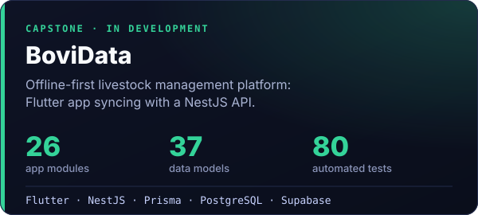
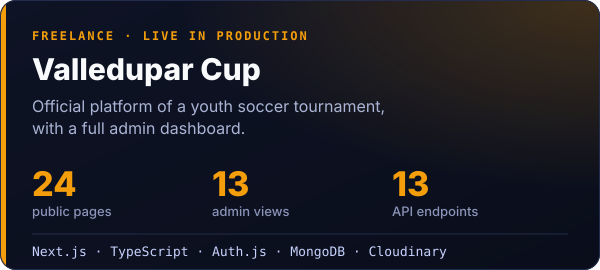
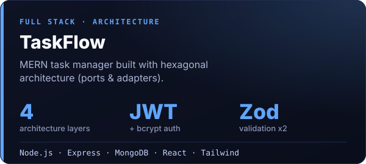
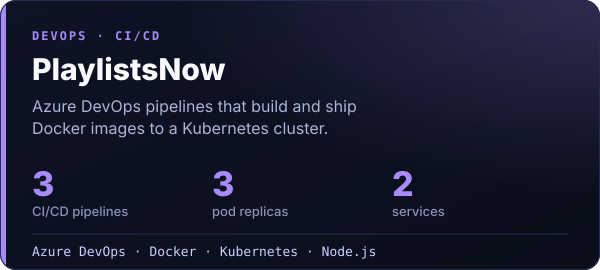

 

 

> **Full Stack Developer** with freelance work in production — I take products from the database to the interface with **Next.js, Node.js/NestJS, PostgreSQL and Flutter**, ship them with **CI/CD**, and integrate **AI**: LLM APIs, RAG and agents. Systems Engineering student in the final stage, based in Valledupar, Colombia 🇨🇴 · open to remote, hybrid or on-site roles.

## ◆ Selected work

  
  

  
  

Also: <a href="https://github.com/0813henry/ecommerce-casco">E-commerce with Stripe</a> · <a href="https://github.com/0813henry/MEAN-Biblioteca">MEAN Library (Angular 20)</a> · <a href="https://github.com/0813henry/Pathfinding">A* / Dijkstra visualizer</a> · Bellnat (Next.js + Three.js) · Strawberry store (Next.js + MongoDB)

## ◆ AI toolkit

| Building AI features | Building *with* AI |
|---|---|
| OpenAI · Anthropic Claude · Google Gemini APIs | Claude Code |
| Vercel AI SDK · LangChain | GitHub Copilot · Cursor |
| RAG · embeddings · pgvector · Atlas Vector Search | OpenAI Codex · Gemini CLI |
| Agents · tool use · Model Context Protocol (MCP) | Playwright MCP for UI testing |
| Local models with Ollama | |

## ◆ Stack

  
   
  

## ◆ Contributions

<picture>
  <source media="(prefers-color-scheme: dark)" srcset="https://raw.githubusercontent.com/0813henry/0813henry/output/github-snake-dark.svg" />
  <source media="(prefers-color-scheme: light)" srcset="https://raw.githubusercontent.com/0813henry/0813henry/output/github-snake.svg" />
  
</picture>
