<div align="center">



</div>

```ts
const henry = {
  role:      "Full Stack Developer · Applied AI",
  location:  "Valledupar, Colombia 🇨🇴",
  education: "Systems Engineering · final stage (capstone: BoviData)",
  building:  ["Next.js apps", "Node.js / NestJS APIs", "Flutter apps", "AI features with LLMs + RAG"],
  workflow:  ["Claude Code", "GitHub Copilot", "Cursor", "Codex"],
  openTo:    "Full Stack & AI roles — remote · hybrid · on-site",
};
```

### `~/shipped`

| | Project | What it does | Proof |
|:-:|---|---|---|
| 🐄 | **BoviData** · `private` | Offline-first livestock platform — Flutter app + NestJS API on PostgreSQL/Supabase | `26 modules` `37 models` `31 endpoints` `80 tests · CI` |
| ⚽ | **[Valledupar Cup](https://www.valleduparcup.co/torneo)** · `live` | Official youth tournament platform with admin dashboard (freelance) | `24 pages` `13 admin views` `13 API endpoints` |
| 🧩 | **[TaskFlow](https://github.com/0813henry/TaskFlow)** | MERN app with hexagonal architecture, JWT + bcrypt, Zod on both ends | `4 layers` `ports & adapters` |
| 🚢 | **[PlaylistsNow](https://github.com/0813henry/playlistsnow)** | Azure DevOps CI/CD → Docker Hub → Kubernetes | `3 pipelines` `3 replicas` |
| 🧭 | **[Pathfinding](https://github.com/0813henry/Pathfinding)** | Classical AI: A* and Dijkstra visualized on a live map | `A*` `Dijkstra` |

### `~/stack`

<p align="left">
  
</p>

<p align="left">
  
  
  
  
  
  
</p>

### `~/contact`

```bash
$ open https://henrypertuzinfo.vercel.app      # portfolio
$ open https://linkedin.com/in/henry-pertuz    # linkedin
$ mail hjosepertuz@gmail.com                   # email
```

<p align="left">
  <a href="https://henrypertuzinfo.vercel.app"></a>
  <a href="https://linkedin.com/in/henry-pertuz"></a>
  <a href="mailto:hjosepertuz@gmail.com"></a>
</p>
